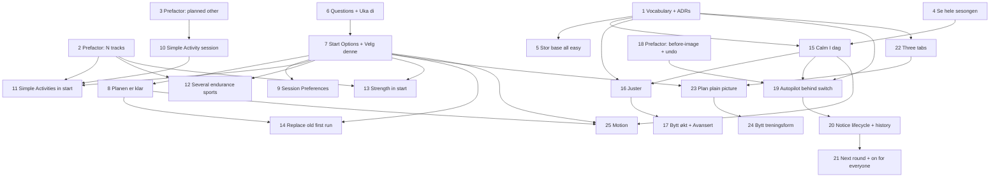

# Levende start — ticket breakdown (published)

Source: spec issue #558 (_Levende start_). Published 2026-10-17 as sub-issues
#559–#583 of #558; see `TICKETS-PUBLISHED.md` for the mapping. Each ticket is a tracer-bullet vertical slice unless marked
**Prefactor**. Prefactors come first so the slices after them are easy
changes.

## Where the ADRs and glossary go, and why

- **Ticket 1 holds the glossary and the three new ADRs** (Autopilot, which
  supersedes ADR 0080 §2–3 and amends ADR 0079 §3; Three tabs and a calm I dag,
  which amends ADR 0083 §1 and ADR 0090 §2 and records the accepted departures
  from ADR 0086 §1, ADR 0082 §5 and ADR 0087; Start Options, which amends ADR
  0048 for _Stor base_). It is its own ticket because each of these ADRs
  overrides an accepted ADR. A slice that lands before them would be code that
  contradicts the decision record, and review would rightly flag it. The owner
  made the decisions on 2026-10-17, so recording them is cheap and fits in one
  context. It also gives every later ticket the same words: **Start Option**,
  **Week Sketch**, **Training Level**, **Session Preference**, **Autopilot**,
  **Autopilot Notice**, **Juster**, and the updated **First Run**, **Week
  Replan**, **Tab Bar**, **Home Timeline**, **Periodization Preset** and
  **Session Adoption**. Ticket 1 gates only the slices that would otherwise
  break an accepted ADR: 5, 15, 16, 19 and 22.
- **The ADR 0015 amendment, with the glossary's **Discipline**, **Annet**,
  **Simple Activity**, **Activity Kind**, **Effort Word** and **Unavailable
  Metric** entries, is folded into ticket 10.** Only the Simple Activity work
  touches ADR 0015, and the ADR records how a planned session on `other` is
  shaped, which is settled in that ticket. Putting it in ticket 1 would make
  the start slices wait for a decision they never read.
- **The strength-frequency glossary sentence** ("from history or from the
  athlete's own answer, never invented") is folded into ticket 13, the slice
  that makes it true.

## Tickets

### 1. Record the Levende start vocabulary and decisions

**Blocked by:** None (can start immediately)

**What it delivers:** Anyone working on _Levende start_ finds every new term
in the glossary and every owner decision in an ADR. No accepted ADR is left
saying the opposite of what the slices will build.

- [ ] The glossary defines Training Level, Session Preference, Start Option (_Avoid_: forslag, suggestion, proposal), Week Sketch (distinct from Week Strip and Pattern Preview), Autopilot, Autopilot Notice and Juster.
- [ ] The glossary updates First Run, Week Replan / Week Replan Proposal / Week Change Card, Tab Bar, Home Timeline, Periodization Preset (_Stor base_ starts all easy) and Session Adoption (the _Juster_ exception for _For sliten i dag_ and _Lite tid_ only).
- [ ] A new Autopilot ADR supersedes ADR 0080 §2–3 and amends ADR 0079 §3. It records autopilot on for every athlete and the migration, _Spør meg først_, the guards, the before-images and undo, the notice, and the _Juster_ exception. ADR 0080 is marked superseded in those sections.
- [ ] A new ADR for three tabs and a calm I dag amends ADR 0083 §1 and ADR 0090 §2's order. It records the today card's return against ADR 0086 §1, and the Stream and Week Strip moving behind _Se hele sesongen_ against ADR 0082 §5 and ADR 0087.
- [ ] A new Start Options ADR amends ADR 0048 (_Stor base_'s first block is all easy) and records the merging of identical options, hours meaning week 1 (confirming ADR 0091 §3), and the start week as ADR 0079's first week not yet begun.

### 2. Prefactor: the first-run draft and plan writer lay any number of Training Tracks

**Blocked by:** None (can start immediately)

**What it delivers:** Nothing changes for the athlete. Today the first run
drafts and writes exactly one endurance track. After this ticket, the draft,
the starter Week Pattern and the open-ended plan writer take a list of tracks,
each with its own discipline, currency, mix and pattern days. Extra sports,
Simple Activities and strength become additions, not rewrites.

- [ ] The draft takes a list of Training Tracks and lays every one through the stamp's own planner. With one track, every existing first-run draft test passes unchanged, for every preset family.
- [ ] The open-ended plan writer creates every track it is given, in the one transaction that checks the athlete has no plan.
- [ ] The existing first-run plan server tests still pass: same days, same minutes, capacity equal to the heaviest week, refusal when a plan exists.
- [ ] A new test holds a two-track draft to "what is made is what was shown", minute for minute.
- [ ] Today's first-run screens behave and read exactly as before.

### 3. Prefactor: a planned session may be on Discipline `other` (expand)

**Blocked by:** None (can start immediately)

**What it delivers:** Nothing changes for the athlete. Today's Discipline set
(run, swim, bike, strength) is switched on in dozens of places, so adding
`other` to it would break them all at once. This ticket adds a wider
"planned discipline" form beside it. It then routes the paths a planned
session travels (session detail, week rows, Planned Volume, Planned TSS,
Training Load contribution) through an explicit **Unavailable Metric** branch
for `other`. The Discipline set itself is not widened (spec: out of scope).

- [ ] A planned session on `other` can be read by session detail, week volumes, Planned TSS and Training Load without a crash or a guessed number. Each of these returns an Unavailable Metric with a reason.
- [ ] The existing Discipline set and every switch on it are unchanged. Type checking proves that every path a planned session travels handles `other` explicitly.
- [ ] Imports of `other` still land in **Annet**, and none of the import paths change.
- [ ] No athlete-facing surface changes yet. Existing tests pass unchanged.

### 4. _Se hele sesongen_: the full Home Timeline at its own address, landing on today

**Blocked by:** None (can start immediately)

**What it delivers:** The athlete can open today's full Home Timeline (Week
Strip, Stream, Writing Line, composer, Season Pane, Day Pane and the Week
Change Card) at its own address. It opens on today, never 26 empty weeks
back. The calm I dag (ticket 15) then links here.

- [ ] The full Home Timeline is reachable at its own address, works exactly as today's I dag does, and keeps the I dag tab active.
- [ ] It lands on today (ADR 0086 §4). For an athlete with a long empty history, the first rows shown are this week's, not an empty week months back. This is covered by a test with that history.
- [ ] On a large screen it opens the three panes (ADR 0087).
- [ ] The home-timeline e2e and declared-motion audit pass at the new address.

### 5. _Stor base_ starts all easy

**Blocked by:** 1

**What it delivers:** Every plan made from _Stor base_ from now on has a first
block, and an open-ended round, with no hard sessions. The athlete sees this in
Sesong's philosophy preview, and _Stor base_ is genuinely different from
_Klassisk 3:1_.

- [ ] _Stor base_'s first block and its open-ended round have an empty Quality Session Mix, and every other preset is unchanged. The preset tests are updated to match.
- [ ] Applying _Stor base_ in Sesong previews and lays weeks with only easy sessions in the first block.
- [ ] Training Tracks already written from _Stor base_ keep their stored mix until the athlete re-applies a philosophy.
- [ ] For a beginner's days and hours, the first-run draft for _Stor base_ and the one for _Klassisk 3:1_ lay different first weeks.

### 6. The simple start's questions with _Uka di_

**Blocked by:** None (can start immediately)

**What it delivers:** A new athlete answers _Hvor er du nå?_ (Training Level),
_Omtrent hvor mye tid i uka?_ and _Hva liker du å trene?_ (one modelled
endurance sport and the days). A live **Week Sketch** (_Uka di_) fills in as
they answer. When they finish, today's plan screen continues with their answers
and the level's first family. This is built beside today's first run (expand),
which stays the entry until ticket 14.

- [ ] The four levels each come with one sentence. The level pre-fills hours and days from the spec's level table. Hours change in half-hour steps with large − and +, are bounded 1–20 with a sentence at each end, and always read with a decimal comma and _time_ / _timer_ (never `0.1`).
- [ ] The days are seven buttons, with a sentence saying how many were picked. A _Nybegynner_ gets at most four sessions, with the most rest between them, and is told so. Seven days keep one day _fri_ and say so. Every picked day is kept as Training Availability.
- [ ] _Uka di_ shows the top option's first week from the widened draft (the same draft the plan is made from): session count, total time, and _Uka di er tom ennå_ before there is anything. A screen reader reads it as a list of days.
- [ ] The answers travel in the URL. The same field schemas read the form and the URL. Going back keeps every answer.
- [ ] Every word comes from the labels module, and the labels completeness test covers it. Route tests drive the loaders and actions. The `mobile-native` checklist and `break-ui` with worst-case answers are run.

### 7. _Tre måter å trene på_: Start Options and _Velg denne_

**Blocked by:** 6

**What it delivers:** After the questions, the athlete sees up to three real
first weeks, laid day by day by the real engine. Each card leads with a plain
name (_Mest rolig, litt veldig hardt_ …) and shows the family's name small. The
athlete swipes between them and picks one with _Velg denne_. That makes exactly
the plan shown, beginning on the first week not yet begun, and takes them to I
dag.

- [ ] The draft returns ranked, distinct Start Options for the level's three families (_Polarisert 80/20_, _Terskelfokus_, _Klassisk 3:1_; _Stor base_ replaces _Terskelfokus_ for _Nybegynner_). _Masters 2:1_ and the age rule are not offered. Options that would lay the same week day for day are merged, with a sentence saying why there are fewer. A test runs this for every level and day count.
- [ ] Each card shows every day (session, activity, duration, effort word, _fri_), a bar of easy, middling and hard time, the total, and the number of hard sessions. Week 1 adds up to the hours given, or a plain sentence says why not. The card says _Planen starter mandag …_.
- [ ] Swipe with pager dots and the arrow keys both move between cards. Each _Velg denne_ carries the card's plain name in its accessible name. A beginner's first card may say _Anbefalt for nivået ditt_, and no card claims _Passer deg best_ yet.
- [ ] _Velg denne_ writes the open-ended plan, its track, Week Pattern, Training Availability, Weekly Capacity and the Training Level in one transaction that refuses when a plan exists. A test against a real database holds the made plan to the shown week minute for minute, and checks that no session gets a completion or _ikke gjort_ and that nothing is laid before the Plan Start Week.
- [ ] An athlete who already has a plan is sent to I dag. Going back to any question recomputes the cards.

### 8. _Planen er klar_

**Blocked by:** 7

**What it delivers:** After _Velg denne_ the athlete sees _Planen er klar_:
the plain name, the day the plan begins, a 12-week curve of hours, one
sentence on how the plan moves each Sunday, a closed _Under panseret_ with
everything that was made, and _Til I dag_.

- [ ] The curve is the Season Pane's curve primitive reading the plan's own derivation for the laid round. The next two rounds are drawn dashed and labelled _hvis du trener som planlagt_ (+5 % per round).
- [ ] _Under panseret_ is a closed, read-only view built from the Sesong readers: family, open-ended, rhythm, Training Tracks with starting volume, Week Pattern, level, and strength frequency and preferences when given.
- [ ] The sentence about Sunday evening, undo and _Spør meg først_ in _Meg_ comes from the labels module.
- [ ] _Til I dag_ lands on I dag. Reloading the screen after the plan exists still shows it, and never makes a second plan.

### 9. Session Preferences order the ways to train

**Blocked by:** 7

**What it delivers:** The athlete says what kinds of sessions they like
(_Hva slags økter liker du?_) or skips with _Hopp over_. The Start Options are
ordered by fit, with _Passer deg best_ on the first when there is a reason.
_Korte økter_ keeps weekday sessions to 45 minutes. The athlete can change
their level and preferences later in _Meg_.

- [ ] The ranking follows the spec's prototype-A scoring with a stable sort. _Passer deg best_ appears only when the top score is above zero. A skip shows no badge, except _Anbefalt for nivået ditt_ on a beginner's _Stor base_.
- [ ] _Korte økter_ caps weekday sessions at 45 minutes, and the card says plainly when that makes the week fall short of the hours. Picking it with _Lange, rolige turer_ gives a sentence explaining how the two are resolved.
- [ ] Preferences never change a family's Quality Session Mix. A draft test holds every family's mix equal with and without preferences.
- [ ] The Session Preferences are stored on the Athlete Profile when the plan is made. _Meg_ shows and edits the Training Level, the activities and the preferences.

### 10. A Simple Activity is a planned session (amends ADR 0015)

**Blocked by:** 3

**What it delivers:** A session can be a **Simple Activity**: a climb, a
_langrenn_ session, a _fjelltur_ or yoga. It has a duration and an Effort Word
(_rolig_ / _middels_ / _hard_) and nothing else. It counts in the week's
hours, shows every other metric as _ikke målt_ with the reason, can be marked
_Gjort_ by hand, and can be linked by hand to an import sitting in **Annet**.

- [ ] ADR 0015 is amended so that `other` is plannable as a Simple Activity, with an Activity Kind and an Effort Word, time and hardness only. The glossary updates Discipline and Annet and adds Simple Activity, Activity Kind, Effort Word and Unavailable Metric.
- [ ] A Simple Activity is a session on Discipline `other` with an Activity Kind, an Effort Word and one step of duration with no Intensity Target. Its Effort Word is never turned into a Training Zone.
- [ ] Its detail and week row show the duration and Effort Word. Zones, pace, power, Planned TSS and Training Load show _ikke målt_ with the reason, never a number.
- [ ] Planned Volume counts its planned minutes. _Gjort_ by hand records the planned minutes as Actual Volume. A hand-linked import's duration replaces them.
- [ ] An import of `other` still lands in Annet and is never auto-linked. Linking it by hand to a planned Simple Activity is allowed and undoable. Demo: a dev athlete with a planned climb.

### 11. Simple Activities in the start

**Blocked by:** 2, 7, 10

**What it delivers:** The athlete can pick _langrenn_, _fjelltur_, _klatring_
and _yoga og bevegelighet_ in the start. Every Start Option places them on
fixed days with their time and effort, counts them in week 1's hours, and says
_Fikk ikke plass denne uka: …_ when one does not fit. The weeks after week 1
keep laying them.

- [ ] All Simple Activities share one hours Training Track on `other`, with no mix and no zones. Each is a fixed Week Pattern day with its Activity Kind, Effort Word and share of the hours.
- [ ] Week 1 of every option adds up to the hours across every hours-counted track, or says why not. An activity that did not fit is named, with what would make room.
- [ ] An athlete who picks no modelled endurance sport is told plainly that they will get one simple week with the sessions spread out, and is shown one option.
- [ ] The made plan matches the shown week minute for minute, Simple Activities included. The horizon fill lays them in the following weeks.

### 12. Several endurance sports in the start

**Blocked by:** 2, 7

**What it delivers:** The athlete can pick more than one of _løping_,
_sykling_ and _svømming_. The first pick becomes the main sport
(_Hovedidrett: Løping_) and carries the family's hard sessions. Each other
sport gets easy sessions on the days left.

- [ ] The main sport's track carries the family's Quality Session Mix. Each other modelled sport gets its own hours track with an empty mix, which keeps one Training Track per Discipline (ADR 0044).
- [ ] The _Hovedidrett_ line shows the main sport, which can be changed by tapping the line or by unpicking and repicking.
- [ ] Week 1 adds up to the hours across every track. Draft tests cover two and three sports for every level.
- [ ] The made plan holds every track and matches the shown week minute for minute.

### 13. Strength in the start

**Blocked by:** 2, 7

**What it delivers:** Picking _styrke_ asks one more tap: _1_, _2_ or _3_
sessions a week. It is pre-set by level, or from lifting history with a line
saying so. Lifting days land away from hard endurance days, shown with their
lifts and counted as _+n styrkeøkt_ beside the hours. The athlete can change
the frequency later in _Meg_.

- [ ] The tap is pre-set from the level table, or from history through the existing strength offer with a line saying so. Whatever is selected is stored as the athlete's answer and shown as theirs on the card and in _Under panseret_.
- [ ] A strength track and fixed lifting days are placed away from the hard endurance days. With no recent strength session to copy, the day uses a full-body Stock Workout from the Catalogue.
- [ ] Strength sessions show their lifts, not invented minutes. They do not count in the hours, and the card says _+n styrkeøkt(er)_.
- [ ] The glossary's strength-frequency sentence reads "from history or from the athlete's own answer, never invented". _Meg_ edits the frequency.

### 14. The simple start replaces the old first run (contract)

**Blocked by:** 7, 8

**What it delivers:** The start is the new flow for every new athlete. An
athlete with intervals.icu connected gets hours and days pre-filled from the
last four weeks, with the arithmetic behind a disclosure. Connecting is a quiet
option on the first screen, and _Jeg vil heller sette opp sesongen selv_ leads
to today's plan authoring. The old connect-first, _Dette fant vi_, questions,
weeks and plan screens are removed.

- [ ] The start's entry is the level screen. An athlete who already has a plan is sent to I dag.
- [ ] With history, hours and days come from today's findings reader (reused without its screen), with a line saying where they came from and the arithmetic (`43 km/uke à 5:35 ≈ 4 t`) behind a disclosure. While the history is still importing, the start says so and uses the level's default.
- [ ] Connecting intervals.icu is a quiet link from the first screen and never required. _Jeg vil heller sette opp sesongen selv_ opens today's plan authoring.
- [ ] The old first-run screens, the start's age-based Masters rule, and their tests and labels are deleted. Old start addresses redirect into the new flow.

### 15. A calm I dag

**Blocked by:** 1, 4

**What it delivers:** I dag opens on a top line (date and plan name), today's
session card with one large _Gjort_, and this week as seven rows with _n av m
økter gjort_, then _Se hele sesongen_. Before the plan starts, it says when
it starts and names the first session. Without a plan, it invites the athlete
to the start. On a large screen, the card and the week sit side by side.

- [ ] The today card shows name, activity, duration, effort word and one sentence. It says _Fri i dag_ with the next session on a free day, and says when today is done with the next session named. _Gjort_ undoes from its toast and from the card (ADR 0088).
- [ ] The week rows show weekday, session, duration and effort word, a done mark, _ikke gjort_ on a past missed day and _fri_ on a free day (never _hvile_ unless the plan prescribes recovery). Their numbers come from the same ledger and week model as the full Home Timeline.
- [ ] _Gjort_ is offered only on today's session and on past sessions not yet done. No future session offers done or missed, and _Marker som ikke gjort_ is never a primary action. Route tests cover this.
- [ ] Every row opens its detail. A completed session with no Workout opens a readable detail, never a 404. Tapping a free day opens today's composer with its undo.
- [ ] Before the Plan Start Week, the card says when the plan starts and names the first session, and adding a session today still works. With no plan, I dag invites the athlete to the start. On a large screen, the card and the week sit side by side and _Se hele sesongen_ opens the three panes.
- [ ] `review-animations`, the `mobile-native` checklist and `break-ui` are run, and the PR says what still needs a real phone.

### 16. _Juster_: _For sliten i dag_, _Lite tid_, _Bytt dag_

**Blocked by:** 1, 15

**What it delivers:** Right above _Gjort_, three thumb-sized chips change only
today's session. _For sliten i dag_ makes it short and easy. _Lite tid_
shortens it. _Bytt dag_ moves it to the next free day, or swaps it with the
next session. Each says what it did in a toast with _Angre_.

- [ ] _For sliten i dag_ makes an endurance session easy at 60 % of its duration with a 20-minute floor. A strength session or Simple Activity keeps its kind and gets _rolig_ and a shorter duration. _Lite tid_ cuts to 30 minutes (20 if it was 30 or less) and keeps the intent.
- [ ] _Bytt dag_ moves the session to the next free day this week, or swaps it with the next session. With no later day, it is refused with a reason. Any chip that cannot act says why.
- [ ] On the machine's session, _For sliten i dag_ and _Lite tid_ do not adopt it (the documented exception). On the athlete's own session they change it and it stays theirs. _Bytt dag_ is a reschedule under the existing rule.
- [ ] Every _Juster_ write leaves a Replan Note, never moves the Week Target, and touches only today's session (plus the one it swaps with). Undo restores the before-image, is idempotent, and is refused after the session is trained.
- [ ] Route tests cover each intent, each refusal, undo, and the no-adoption rule. Every word comes from the labels module.

### 17. _Bytt økt_ and _Avansert_ on today's session

**Blocked by:** 16

**What it delivers:** _Bytt økt_ opens _Bibliotek_ as a picker, and the
chosen session replaces today's with _Angre_. _Avansert_, the fourth chip,
leads to the session detail, the composer and _Plan_'s editors, so power tools
are one tap away.

- [ ] _Bytt økt_ opens the Catalogue, programs and exercises as a picker. The pick replaces today's prescription with a toast and _Angre_.
- [ ] _Bytt økt_ adopts the session under the normal rule (not the _Juster_ exception), and a route test holds it to that.
- [ ] _Avansert_ links to the session detail, the composer and the Sesong / _Plan_ editors. Until the three tabs land, that means today's Sesong page.
- [ ] Undo restores today's previous session exactly and is refused after the session is trained.

### 18. Prefactor: an applied proposal keeps a before-image and can be undone

**Blocked by:** None (can start immediately)

**What it delivers:** Nothing changes for the athlete. Today, every applied
Week Replan Proposal (by Ok or by silence) overwrites the sessions it changes.
After this ticket, each one also records the prescription and placement it
replaced, and a server-side undo puts the week back exactly. Autopilot's
_Angre_ then has an engine to call.

- [ ] Applying any proposal kind (keep, move, swap, add, scale) stores a before-image of every session it changed. A next round stores what it appended.
- [ ] Undo restores the before-image exactly, is idempotent, and is refused with a reason once the target week has begun or a changed session has been trained (ADR 0088's refuse-rather-than-trample rule).
- [ ] Undoing a next round re-lays it at factor 1 rather than removing it, so the plan never ends.
- [ ] The existing week-change and proposal tests pass unchanged. New server tests with an injected clock cover undo for each kind.

### 19. Autopilot, switched on in _Meg_

**Blocked by:** 1, 15, 18

**What it delivers:** An athlete who switches autopilot on in _Meg_ no longer
answers _Ukeskiftet_. At Sunday's close the app applies the coming week's
changes within the guards, and I dag shows _Neste uke er lagt ut_ with one
line per change, its reason, _Angre_ and _Angre alt_. _Spør meg først_ stays
today's behaviour, and is the default until ticket 21. How long the notice
stays on I dag, its history and the could-not-lay line come in ticket 20.

- [ ] A per-athlete Autopilot setting (default _Spør meg først_ in this ticket) is shown and switched in _Meg_. Switching it applies from the next close and never applies open proposals retroactively.
- [ ] With autopilot on, the week change applies every proposal whose target is the machine's at the close, including added load, within the guards: at most 5 % per round and never past the ramp guard's 8 % week-on-week. Make-up copies are not placed, and the missed session stays _ikke gjort_. Sessions that are `authored`, adopted and not released are left alone. The 06:00 silence step does nothing for autopilot athletes.
- [ ] The Autopilot Notice sits on I dag above the week. Each line states what changed and why (the stored reason) with _Angre_, plus _Angre alt_. A session left alone or a missed session let go is said in a line. _Gjør uka lettere −15 %_ stays available.
- [ ] Server tests run the weekly step for one athlete with an injected clock: applied at close, guards, own sessions untouched, make-up not placed, undo exact and refused after the week begins, and _Spør meg først_ unchanged.

### 20. The Autopilot Notice's lifecycle and history

**Blocked by:** 19

**What it delivers:** Split from ticket 19 (see the sizing note). The
Autopilot Notice stops being a fixture: it leaves I dag once the athlete has
seen it and the week has begun, and every notice stays findable in _Se hele
sesongen_. A week that could not be laid is said plainly in the notice instead
of passing in silence.

- [ ] The notice stays on I dag until it has been seen and the week has begun, then leaves. Neither alone removes it.
- [ ] Past notices, with their lines and reasons, stay findable in _Se hele sesongen_ at the week they belong to.
- [ ] A week that could not be laid says so in the notice, with the reason.
- [ ] Every word comes from the labels module. Tests with an injected clock cover the notice staying before it is seen or before the week begins, leaving after both, the history in _Se hele sesongen_, and the could-not-lay line.

### 21. Autopilot runs the open-ended plan, on for everyone

**Blocked by:** 20

**What it delivers:** An open-ended plan's next round is appended at its
proposed volume without a yes, and can be undone. Autopilot becomes the
default for every athlete, including those with a plan today. Their first
notice carries one line saying the app now lays out their weeks and where
_Spør meg først_ is.

- [ ] With autopilot on, the next round is applied at the close at its proposed factor, within the guards, and shown as a notice line with before → after in hours (_Toppuka: 4 → 4,2 t_). _Angre_ re-lays it at factor 1.
- [ ] A data migration sets autopilot on for every existing athlete, and new athletes default to it. The migration ships as a migration, never as seed data.
- [ ] A migrated athlete's first notice carries the one-time line about the change and where to switch back. It never appears again.
- [ ] Tests cover a migrated athlete's first close and a new athlete's first close. Under _Spør meg først_, the next round still waits for a yes (ADR 0079 §3).

### 22. Three tabs: _I dag_, _Plan_, _Meg_

**Blocked by:** 1

**What it delivers:** The Tab Bar has three tabs. _Plan_ is today's Sesong
page under a new name, with _Bibliotek_ (Catalogue, programs, exercises,
unchanged inside) as a section of it. Every old Sesong and Bibliotek link and
bookmark still works and lands in _Plan_ with the _Plan_ tab active.

- [ ] The tab registry is the one place that changes: three tabs, _Plan_ home to every URL Sesong and Bibliotek were home to.
- [ ] _Bibliotek_ is a section of _Plan_. Every old Bibliotek address lands in it, with _Plan_ active and `aria-current` correct.
- [ ] The tab words come from the labels module. Tab-bar tests cover every old URL.
- [ ] The `mobile-native` checklist is run on the bar, with targets of at least 44 px and the bar in the thumb zone.

### 23. _Plan_ leads with the plain picture

**Blocked by:** 7, 22

**What it delivers:** _Plan_ opens on the plan's plain name with the family
small, the season as one curve with this week and the next easy week marked,
and _Legg til et løp_. Below come _Bibliotek_, and a closed _Avansert_ holding
today's Sesong editors exactly as they work now.

- [ ] The lead shows the plain name (the same labels as the Start Options) and the family small, the season curve (ADR 0090 §1) with this week marked, and the next easy week.
- [ ] _Legg til et løp_ turns an open-ended plan into a plan toward a race (ADR 0079 §4).
- [ ] _Avansert_ is closed by default and holds philosophy, week targets, phases, Training Tracks, Week Pattern and the season chart. The existing Sesong tests pass inside it.
- [ ] An athlete without a plan is invited to the start.

### 24. _Bytt treningsform_ through the Start Options

**Blocked by:** 23

**What it delivers:** From _Plan_ the athlete sees the three ways to train
again, as real weeks laid for their plan's tracks and days. Picking one
switches the philosophy through today's philosophy switch, behind its preview.

- [ ] _Bytt treningsform_ shows the ranked, distinct Start Options for the athlete's stored level, preferences, tracks and days, with the current family marked.
- [ ] Picking one goes through today's philosophy preview and switch (ADR 0079 S7). Nothing is applied without the preview's confirmation.
- [ ] Sessions the athlete wrote or took over are untouched by the switch, as today.
- [ ] Route tests cover the options shown, the preview and the applied switch.

### 25. Motion that explains

**Blocked by:** 7, 8, 15

**What it delivers:** _Uka di_ morphs into the option cards, the chosen card
into the plan curve, and the curve into the I dag week. The first _Gjort_ on a
session gets a few earned sparks. With reduced motion, every morph is a gentle
cross-fade and the sparks become a calm check fade.

- [ ] The shared-element morphs take 280 ms on `--ease-in-out`. _Uka di_ blocks enter with a 30 ms stagger and leave in 160 ms. Only transform, opacity and clip-path animate.
- [ ] View Transitions are used where available, with an instant fallback. Back navigation reverses the motion, and rapid taps skip a running transition.
- [ ] The celebration is 8 sparks over 300 ms from the check, compositor-only, once per session and never on undo.
- [ ] Reduced motion uses a 200 ms cross-fade for every morph and no sparks, never zero motion (ADR 0077).
- [ ] The e2e tests cover the morphs, their reduced-motion fades and the celebration. The home-timeline declared-motion audit gets the new list. `review-animations` has no Block left.

## Dependency graph

## Initial frontier

1 (vocabulary and ADRs), 2 (prefactor: N tracks), 3 (prefactor: planned
`other`), 4 (_Se hele sesongen_), 6 (questions and _Uka di_), 18 (prefactor:
before-image and undo).

## Notes on sizing

- **19 (Autopilot behind a switch)** was the largest ticket: setting, apply
  step, guards, notice and its lifecycle. It is split: the notice's lifecycle
  and history (seen, week begun, findable in _Se hele sesongen_,
  could-not-lay) are ticket 20, blocked by 19. Everything that was blocked by
  19 is now blocked by 20.
- **15 (Calm I dag)** is the next largest. The before-start, no-plan and
  large-screen states can split off if needed.
- 5 has no route of its own. It is demoable through Sesong's philosophy preview.
